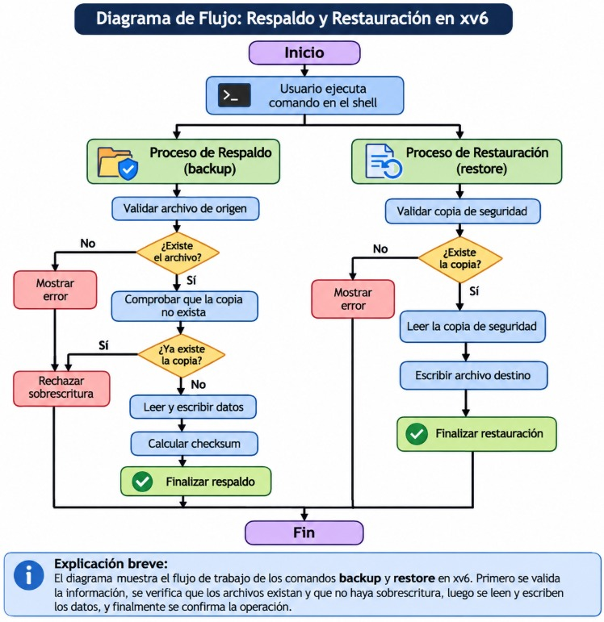

# RESTAURACIÓN DE ARCHIVOS DESDE COPIA DE SEGURIDAD EN XV6

**UNIVERSIDAD NACIONAL SAN CRISTÓBAL DE HUAMANGA**  
FACULTAD DE MINAS, GEOLOGÍA Y CIVIL  
ESCUELA PROFESIONAL DE INGENIERÍA DE SISTEMAS  
**Curso:** Sistemas Operativos (IS – 380)  
**Docente:** JAICO QUISPE, Lizbeth  
**Estudiantes:**
CCONISLLA RIVERA, Climner Antony
CANCHO QUISPE,Carlos
AVILA CONTRERAS,Nelsson
CARRILLO TINEO, Jhonatan
CONTRERAS JANAMPA,Robinson Ismael
**Ayacucho – Perú, 2026**

---

## 1. Introducción
Este proyecto aborda la implementación de un sistema de respaldo y restauración de archivos en el sistema operativo educativo xv6 (basado en arquitectura RISC-V). La propuesta consistió en desarrollar herramientas de usuario que permitieran recuperar información ante una eliminación accidental o modificación no deseada. A lo largo de este informe se detalla el recorrido de los datos desde la consola de xv6 hasta las llamadas al sistema, el diseño de los comandos `backup` y `restore`, y la validación del sistema mediante un entorno automatizado de pruebas.

## 2. Planteamiento del Problema
La pérdida o modificación accidental de un archivo puede interrumpir el trabajo de un usuario. En sistemas operativos educativos como xv6, no existe una herramienta nativa que permita crear copias de seguridad verificadas y restaurarlas de forma segura. Si existe una copia, pero no un procedimiento controlado para devolverla a su ubicación original, la recuperación depende de acciones manuales propensas a errores. 

**Justificación:** El desarrollo de este sistema permitió estudiar de forma práctica la interacción entre los programas de usuario y el sistema de archivos del núcleo. Además, promovió la implementación de políticas de seguridad, como la validación de rutas y la protección contra la sobrescritura de archivos existentes.

## 3. Objetivos
**Objetivo General:**
Implementar y validar un mecanismo de respaldo y restauración de archivos en el sistema operativo xv6, garantizando la integridad de los datos y el manejo controlado de errores.

**Objetivos Específicos:**
* Desarrollar los comandos `backup` y `restore` utilizando las llamadas al sistema de xv6 (`open`, `read`, `write`, `close`).
* Integrar una función de cálculo de checksum para verificar la integridad del contenido respaldado.
* Diseñar un programa de pruebas automatizadas (`test_backup.c`) que evalúe casos exitosos y condiciones de error (archivos inexistentes, vacíos y extensos).
* Documentar la arquitectura, implementación y resultados de las pruebas realizadas en el entorno xv6.

## 4. Fundamento Teórico
**Copias de Seguridad en Sistemas Unix:** Una copia de seguridad permite recuperar datos tras una pérdida. En sistemas tipo Unix, esto se logra mediante la lectura de bytes de un archivo origen y su escritura en un archivo destino.

**El Sistema de Archivos de xv6:** xv6-riscv organiza los archivos mediante inodos y bloques de datos. Los programas de usuario interactúan con el sistema de archivos a través de llamadas al sistema (syscalls) que el núcleo traduce en operaciones sobre el disco. Para este proyecto, se utilizaron las syscalls estándar disponibles en la biblioteca `user.h`.

## 5. Análisis y Diseño de la Solución
La solución se diseñó como un conjunto de programas de usuario invocables desde la consola de xv6. El flujo de funcionamiento se dividió en dos fases: respaldo y restauración.
* **Fase de Respaldo (`backup.c`):** El programa abre el archivo origen en modo lectura y verifica mediante la función `stat` si el archivo destino ya existe. Si no existe, procede a leer en bloques y a escribir en el destino. Durante la escritura, calcula un *checksum* (suma de comprobación) de los bytes transferidos para garantizar la integridad.
* **Fase de Restauración (`restore.c`):** El programa recibe la ruta del respaldo y el destino. Abre el respaldo, lee el contenido y lo escribe en el nuevo archivo, manejando los errores si la copia no existe.

*Nota sobre el control de versiones:* El diseño del comando de respaldo integró en un solo archivo (`backup.c`) las funcionalidades iniciales y las mejoras de seguridad y checksum. Esta continuidad en Git conserva el historial de cambios y evita mantener copias paralelas del comando.

## 6. Implementación
Se modificaron e incorporaron los siguientes componentes en el código fuente de xv6:
* **Programas de usuario:** Se crearon los archivos `user/backup.c`, `user/restore.c` y `user/test_backup.c`.
* **Makefile:** Se actualizó el archivo `Makefile` en la raíz del proyecto para incluir los nuevos ejecutables en la variable `UPROGS`, permitiendo que se compilen y se incluyan en la imagen del sistema de archivos (`fs.img`).
* **Interfaz de sistema:** No se requirió la creación de nuevas llamadas al sistema; se reutilizaron las syscalls existentes de xv6.

*(Insertar aquí Figura 1: Código de backup.c)*
*(Insertar aquí Figura 2: Código de restore.c)*

## 7. Pruebas
Para validar el sistema, se desarrolló el programa `user/test_backup.c`, el cual automatiza 8 casos de prueba (CP01 a CP08) mediante llamadas a `fork` y `exec`.

**Tabla 1**  
*Resultados de los casos de prueba automatizados*
| Caso | Procedimiento | Resultado Esperado | Resultado Obtenido |
| :--- | :--- | :--- | :--- |
| CP01-03 | Backup, Restore y verificación normal | El archivo se respalda, se restaura y el checksum coincide. | **Éxito (OK)** - El sistema realizó las operaciones correctamente. |
| CP04 | Backup de archivo inexistente | El sistema muestra un error controlado. | **Éxito (Error controlado)** - Mensaje: "no se puede abrir el origen". |
| CP05 | Restore de copia inexistente | El sistema muestra un error controlado. | **Éxito (Error controlado)** - Mensaje: "no existe la copia". |
| CP07 | Restaurar archivo vacío (0 bytes) | El archivo se restaura vacío. | **Éxito (OK)** - Checksum 0. |
| CP08 | Restaurar archivo extenso (2048 bytes) | El archivo se restaura completo. | **Éxito (OK)** - Checksum correcto. |

**Figura 3**  
*Ejecución manual en xv6: respaldo con checksum, restauración y manejo de errores*  

 
## 8. Análisis de Resultados
Los resultados obtenidos demuestran que el sistema de respaldo y restauración funciona de manera robusta en xv6. Los casos CP01 a CP03 confirmaron que la transferencia de datos es íntegra. Los casos CP04 y CP05 demostraron que el programa es capaz de manejar errores sin colapsar el sistema operativo. El caso CP07 validó el manejo de archivos vacíos, y el CP08 confirmó que la lectura por bloques (con un buffer de 512 bytes, definido en `MAX_BUF`) permite manejar archivos más grandes sin problemas de desbordamiento.

**Limitaciones:** El sistema actual no programa respaldos automáticos, no cifra los datos y requiere que el usuario conozca las rutas exactas. Además, si hay un corte de energía durante la escritura, el archivo de destino podría quedar incompleto.

## 9. Conclusiones y Recomendaciones
**Conclusiones:**
* Se implementó con éxito un sistema de respaldo y restauración en xv6, logrando recuperar archivos de manera segura.
* La integración del *checksum* y la protección contra sobrescritura demostraron ser medidas efectivas para evitar la pérdida de datos.
* El programa de pruebas automatizadas (`test_backup.c`) demostró ser una herramienta valiosa para validar el software de sistemas operativos, cubriendo tanto el "camino feliz" como los casos límite.

**Recomendaciones:**
* Mantener la copia de seguridad en una ruta separada del archivo original.
* Para futuros proyectos, se recomienda agregar una interfaz de línea de comandos más amigable o una opción para programar respaldos automáticos.

## 10. Referencias Bibliográficas
Cox, R., Kaashoek, F., & Morris, R. (2025). *xv6: A simple, Unix-like teaching operating system* (RISC-V ed.). Massachusetts Institute of Technology. https://pdos.csail.mit.edu/6.828/2025/xv6/book-riscv-rev5.pdf

MIT PDOS. (2026). *xv6-riscv* [Código fuente]. GitHub. https://github.com/mit-pdos/xv6-riscv
