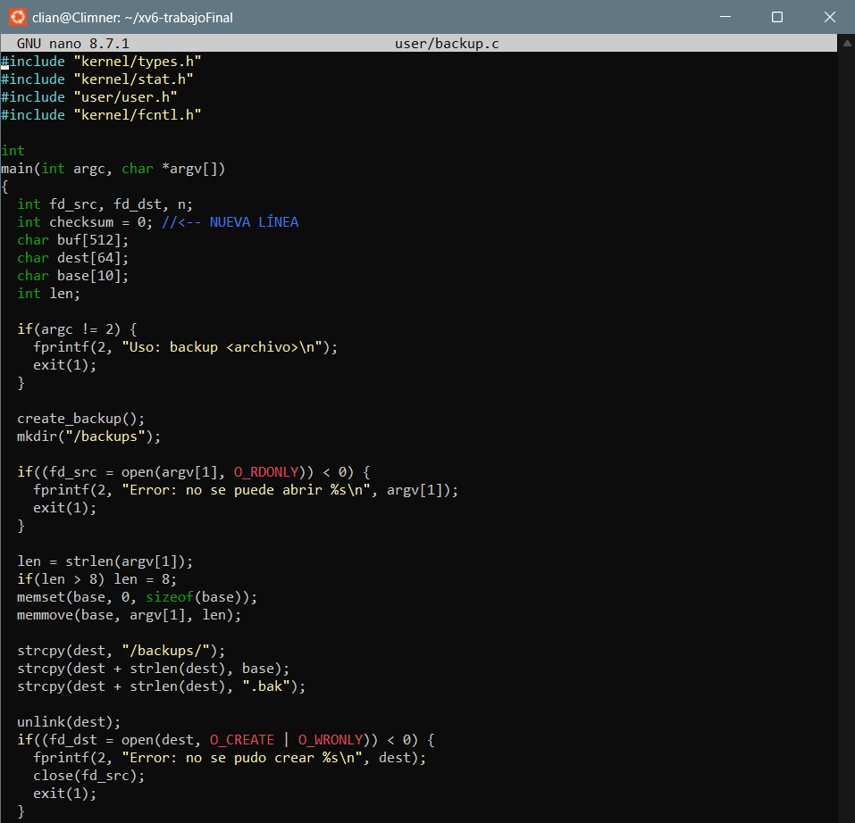
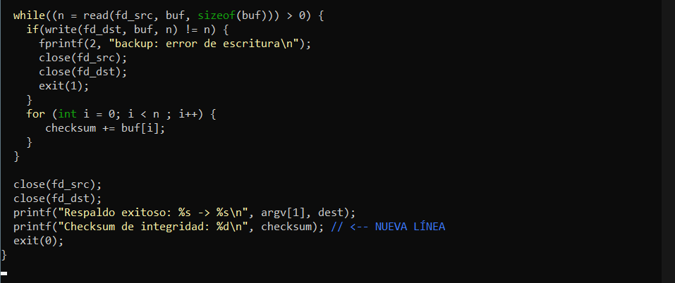
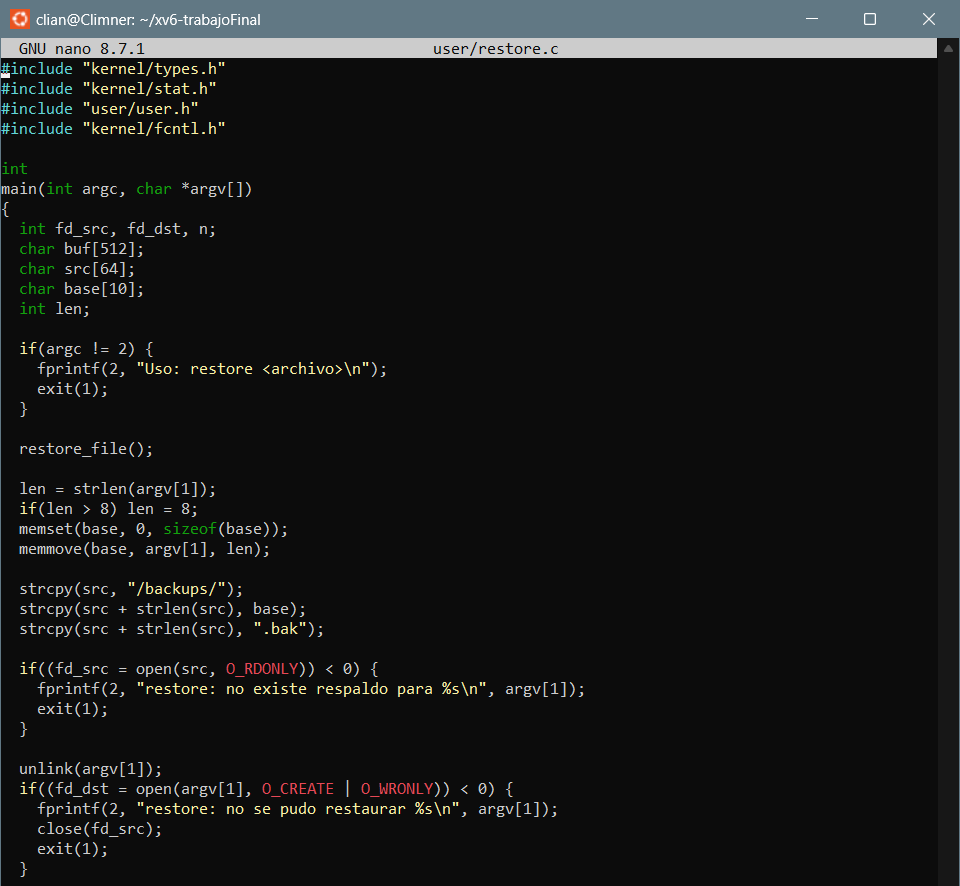
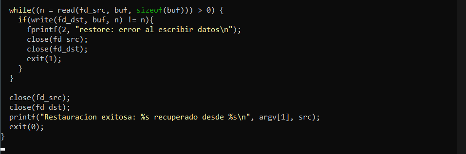
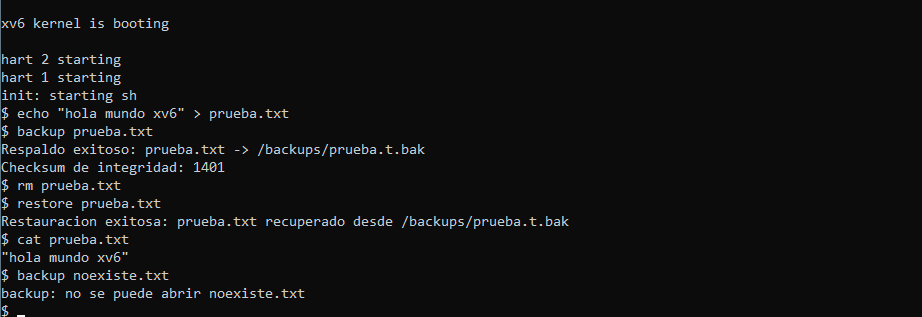
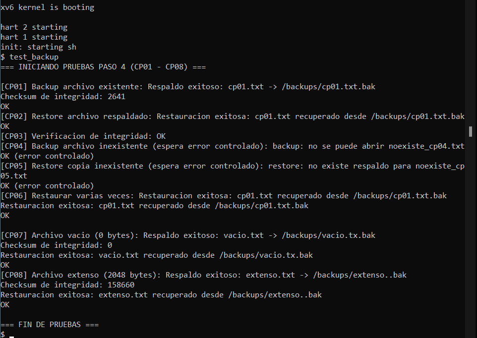

<div align="center">

# UNIVERSIDAD NACIONAL SAN CRISTÓBAL DE HUAMANGA
### FACULTAD DE MINAS, GEOLOGÍA Y CIVIL
**ESCUELA PROFESIONAL DE INGENIERÍA DE SISTEMAS**

---

**CURSO:** Sistemas Operativos (IS – 380)

**DOCENTE:** JAICO QUISPE, Lizbeth

**TÍTULO DEL PROYECTO:**
## RESTAURACIÓN DE ARCHIVOS DESDE COPIA DE SEGURIDAD EN XV6

**INTEGRANTES:**

AVILA CONTRERAS, Nelsson

CANCHO QUISPE, Carlos

CARRILLO TINEO, Jhonatan

CONTRERAS JANAMPA, Robinson Ismael

CCONISLLA RIVERA, Climner Antony

*Ayacucho – Perú, 2026*

---
</div>
---
<div align="justify">
## 1. Introducción

Este proyecto aborda la implementación de un sistema de respaldo y restauración de archivos en el sistema operativo educativo xv6 (basado en arquitectura RISC-V). La propuesta consistió en desarrollar herramientas de usuario que permitieran recuperar información ante una eliminación accidental o modificación no deseada. A lo largo de este informe se detalla el recorrido de los datos desde la consola de xv6 hasta las llamadas al sistema, el diseño de los comandos `backup` y `restore`, y la validación del sistema mediante un entorno automatizado de pruebas.
</div>

<div align="justify">
## 2. Planteamiento del Problema

La pérdida o modificación accidental de un archivo puede interrumpir el trabajo de un usuario. En sistemas operativos educativos como xv6, no existe una herramienta nativa que permita crear copias de seguridad verificadas y restaurarlas de forma segura. Si existe una copia, pero no un procedimiento controlado para devolverla a su ubicación original, la recuperación depende de acciones manuales propensas a errores. 

**Justificación:** 

El desarrollo de este sistema permitió estudiar de forma práctica la interacción entre los programas de usuario y el sistema de archivos del núcleo. Además, promovió la implementación de políticas de seguridad, como la validación de rutas y la protección contra la sobrescritura de archivos existentes.
</div>

<div align="justify">
## 3. Objetivos

**Objetivo General:**

Implementar y validar un mecanismo de respaldo y restauración de archivos en el sistema operativo xv6, garantizando la integridad de los datos y el manejo controlado de errores.

**Objetivos Específicos:**

* Desarrollar los comandos `backup` y `restore` utilizando las llamadas al sistema de xv6 (`open`, `read`, `write`, `close`).
* Integrar una función de cálculo de checksum para verificar la integridad del contenido respaldado.
* Diseñar un programa de pruebas automatizadas (`test_backup.c`) que evalúe casos exitosos y condiciones de error (archivos inexistentes, vacíos y extensos).
* Documentar la arquitectura, implementación y resultados de las pruebas realizadas en el entorno xv6.
</div>

<div align="justify">
## 4. Fundamento Teórico

**Copias de Seguridad en Sistemas Unix:** 

Una copia de seguridad permite recuperar datos tras una pérdida. En sistemas tipo Unix, esto se logra mediante la lectura de bytes de un archivo origen y su escritura en un archivo destino.

**El Sistema de Archivos de xv6:** 

xv6-riscv organiza los archivos mediante inodos y bloques de datos. Los programas de usuario interactúan con el sistema de archivos a través de llamadas al sistema (syscalls) que el núcleo traduce en operaciones sobre el disco. Para este proyecto, se utilizaron las syscalls estándar disponibles en la biblioteca `user.h`.
</div>

<div align="justify">
## 5. Análisis y Diseño de la Solución

La solución se diseñó como un conjunto de programas de usuario invocables desde la consola de xv6. El flujo de funcionamiento se dividió en dos fases: respaldo y restauración.
* **Fase de Respaldo (`backup.c`):** El programa abre el archivo origen en modo lectura y verifica mediante la función `stat` si el archivo destino ya existe. Si no existe, procede a leer en bloques y a escribir en el destino. Durante la escritura, calcula un *checksum* (suma de comprobación) de los bytes transferidos para garantizar la integridad.
* **Fase de Restauración (`restore.c`):** El programa recibe la ruta del respaldo y el destino. Abre el respaldo, lee el contenido y lo escribe en el nuevo archivo, manejando los errores si la copia no existe.


*Nota sobre el control de versiones:* El diseño del comando de respaldo integró en un solo archivo (`backup.c`) las funcionalidades iniciales y las mejoras de seguridad y checksum. Esta continuidad en Git conserva el historial de cambios y evita mantener copias paralelas del comando.
</div>

<div align="justify">
## 6. Implementación

Se modificaron e incorporaron los siguientes componentes en el código fuente de xv6:
* **Programas de usuario:** Se crearon los archivos `user/backup.c`, `user/restore.c` y `user/test_backup.c`.
* **Makefile:** Se actualizó el archivo `Makefile` en la raíz del proyecto para incluir los nuevos ejecutables en la variable `UPROGS`, permitiendo que se compilen y se incluyan en la imagen del sistema de archivos (`fs.img`).
* **Interfaz de sistema:** No se requirió la creación de nuevas llamadas al sistema; se reutilizaron las syscalls existentes de xv6.

<div align="center">
  
  <p><i><strong>Figura 1:</strong> Código del comando de respaldo (backup.c) - Parte 1 : Inclusión de librerias y estructura principal</i></p>
</div>
<br>

<div align="center">
  
  <p><i><strong>Figura 2:</strong> Código del comando de respaldo (backup.c) - Parte 2 : Bucle de lectura, escritura y cálculo de Checksum</i></p>
</div>
<br>

<div align="center">
  
  <p><i><strong>Figura 3:</strong> Código del comando de restauración (restore.c) - Parte 1</i></p>
</div>
<br>

<div align="center">
  
  <p><i><strong>Figura 4:</strong> Código del comando de restauración (restore.c) - Parte 2</i></p>
</div>

<div align="justify">
## 7. Pruebas

Para validar el sistema, se desarrolló el programa `user/test_backup.c`, el cual automatiza 8 casos de prueba (CP01 a CP08) mediante llamadas a `fork` y `exec`.

**Tabla 1**  
*Resultados de los casos de prueba automatizados en xv6*
| Caso | Procedimiento | Resultado Esperado | Resultado Obtenido |
| :--- | :--- | :--- | :--- |
| CP01 | Respaldo de archivo existente (`cp01.txt`). | El archivo se respalda y se genera un checksum. | **Éxito (OK)** - Checksum: 2641. |
| CP02 | Restauración del archivo respaldado. | El archivo se recupera en su destino. | **Éxito (OK)** - Restauración exitosa. |
| CP03 | Verificación de integridad. | El contenido restaurado coincide con el original. | **Éxito (OK)** - Validación correcta. |
| CP04 | Backup de archivo inexistente. | El sistema muestra un error controlado sin colapsar. | **Éxito (OK)** - Mensaje: "backup: no se puede abrir...". |
| CP05 | Restore de copia inexistente. | El sistema muestra un error controlado sin colapsar. | **Éxito (OK)** - Mensaje: "restore: no existe respaldo...". |
| CP06 | Restaurar el mismo archivo varias veces. | El sistema soporta restauraciones múltiples sin errores. | **Éxito (OK)** - Dos restauraciones exitosas. |
| CP07 | Archivo vacío (0 bytes). | El archivo se respalda y restaura correctamente. | **Éxito (OK)** - Checksum: 0. |
| CP08 | Archivo extenso (2048 bytes). | El archivo grande se procesa por bloques correctamente. | **Éxito (OK)** - Checksum: 158660. |

<div align="center">
  
  <p><i><strong>Figura 5:</strong> Ejecución manual en xv6: respaldo con checksum, restauración y manejo de errores.</i></p>
</div>

<br>

<div align="center">
  
  <p><i><strong>Figura 6:</strong> Salida de la suite de pruebas automatizadas (CP01 - CP08) demostrando la robustez del sistema.</i></p>
</div>

## 8. Análisis de Resultados

**Interpretación de los resultados**

Los resultados obtenidos demuestran que el sistema de respaldo y restauración funciona de manera robusta en xv6. Los casos CP01 a CP03 confirmaron que la transferencia de datos es íntegra. Los casos CP04 y CP05 demostraron que el programa es capaz de manejar errores sin colapsar el sistema operativo. El caso CP07 validó el manejo de archivos vacíos, y el CP08 confirmó que la lectura por bloques (con un buffer de 512 bytes, definido en `MAX_BUF`) permite manejar archivos más grandes sin problemas de desbordamiento.

**Limitaciones:** 

El sistema actual no programa respaldos automáticos, no cifra los datos y requiere que el usuario conozca las rutas exactas. Además, si hay un corte de energía durante la escritura, el archivo de destino podría quedar incompleto.
</div>

<div align="justify">
## 9. Conclusiones y Recomendaciones

**Conclusiones:**

* Se implementó con éxito un sistema de respaldo y restauración en xv6, logrando recuperar archivos de manera segura.
* La integración del *checksum* y la protección contra sobrescritura demostraron ser medidas efectivas para evitar la pérdida de datos.
* El programa de pruebas automatizadas (`test_backup.c`) demostró ser una herramienta valiosa para validar el software de sistemas operativos, cubriendo tanto el "camino feliz" como los casos límite.

**Recomendaciones:**

* Mantener la copia de seguridad en una ruta separada del archivo original.
* Para futuros proyectos, se recomienda agregar una interfaz de línea de comandos más amigable o una opción para programar respaldos automáticos.
</div>

<div align="justify">
## 10. Referencias Bibliográficas

Cox, R., Kaashoek, F., & Morris, R. (2025). *xv6: A simple, Unix-like teaching operating system* (RISC-V ed.). Massachusetts Institute of Technology. https://pdos.csail.mit.edu/6.828/2025/xv6/book-riscv-rev5.pdf

MIT PDOS. (2026). *xv6-riscv* [Código fuente]. GitHub. https://github.com/mit-pdos/xv6-riscv
</div>
---

## Anexos

### Anexo A: Código fuente de la suite de pruebas (`test_backup.c`)
El siguiente bloque presenta el código implementado en C para automatizar la validación de los 8 casos de prueba (CP01 - CP08) dentro de xv6.

```c
#include "kernel/types.h"
#include "kernel/stat.h"
#include "user/user.h"
#include "kernel/fcntl.h"

#define CMD_BACKUP "backup"
#define CMD_RESTORE "restore"

int run_cmd2(char *cmd, char *arg1, char *arg2) {
    int pid = fork();
    if (pid < 0) {
        printf("Error en fork\n");
        return -1;
    }
    if (pid == 0) {
        char *argv[] = {cmd, arg1, 0}; 
        exec(cmd, argv);
        printf("Error: no se pudo ejecutar %s\n", cmd);
        exit(1);
    }
    int status = 0;
    wait(&status);
    return status;
}

  Función para crear un archivo con contenido específico
int create_file(char *name, char *data, int len) {
    int fd = open(name, O_CREATE | O_WRONLY | O_TRUNC);
    if (fd < 0) return -1;
    if (len > 0 && write(fd, data, len) != len) {
        close(fd);
        return -1;
    }
    close(fd);
    return 0;
}

// Función para verificar si un archivo tiene el contenido esperado
int verify_file(char *name, char *expected, int len) {
    int fd = open(name, O_RDONLY);
    if (fd < 0) return 0;

    struct stat st;
    if (fstat(fd, &st) < 0 || st.size != len) {
        close(fd);
        return 0;
    }

    char buf[256];
    int total = 0;
    while (total < len) {
        int n = read(fd, buf, sizeof(buf));
        if (n <= 0) break;
        for (int i = 0; i < n; i++) {
            if (buf[i] != expected[total + i]) {
                close(fd);
                return 0;
            }
        }
        total += n;
    }
    close(fd);
    return (total == len);
}

int main(void) {
    printf("=== INICIANDO PRUEBAS PASO 4 (CP01 - CP08) ===\n\n");
    char *texto = "Datos criticos de prueba xv6\n";
    int len = strlen(texto);

    // CP01: Respaldo
    printf("[CP01] Backup archivo existente: ");
    create_file("cp01.txt", texto, len);
    if (run_cmd2(CMD_BACKUP, "cp01.txt", "") == 0)
        printf("OK\n");
    else
        printf("FALLÓ\n");

    // CP02 y CP03: Restaurar y verificar
    unlink("cp01.txt");
    printf("[CP02] Restore archivo respaldado: ");
    if (run_cmd2(CMD_RESTORE, "cp01.txt", "") == 0)
        printf("OK\n");
    else
        printf("FALLÓ\n");

    printf("[CP03] Verificacion de integridad: ");
    if (verify_file("cp01.txt", texto, len))
        printf("OK\n");
    else
        printf("FALLÓ\n");

    // CP04: Error controlado en backup
    printf("[CP04] Backup archivo inexistente (espera error controlado): ");
    if (run_cmd2(CMD_BACKUP, "noexiste_cp04.txt", "") != 0)
        printf("OK (error controlado)\n");
    else
        printf("FALLÓ\n");

    // CP05: Error controlado en restore
    printf("[CP05] Restore copia inexistente (espera error controlado): ");
    if (run_cmd2(CMD_RESTORE, "noexiste_cp05.txt", "") != 0)
        printf("OK (error controlado)\n");
    else
        printf("FALLÓ\n");

    // CP06: Restaurar varias veces
    printf("[CP06] Restaurar varias veces: ");
    int r1 = run_cmd2(CMD_RESTORE, "cp01.txt", "");
    int r2 = run_cmd2(CMD_RESTORE, "cp01.txt", "");
    if (r1 == 0 && r2 == 0 && verify_file("cp01.txt", texto, len))
        printf("OK\n");
    else
        printf("FALLÓ\n");

    // CP07: Archivo vacio
    printf("\n[CP07] Archivo vacio (0 bytes): ");
    create_file("vacio.txt", "", 0);
    run_cmd2(CMD_BACKUP, "vacio.txt", "");
    unlink("vacio.txt");
    run_cmd2(CMD_RESTORE, "vacio.txt", "");
    if (verify_file("vacio.txt", "", 0))
        printf("OK\n");
    else
        printf("FALLÓ\n");

    // CP08: Archivo extenso (2048 bytes)
    printf("[CP08] Archivo extenso (2048 bytes): ");
    char extenso[2048];
    for (int i = 0; i < 2048; i++) extenso[i] = 'A' + (i % 26);
    create_file("extenso.txt", extenso, 2048);
    run_cmd2(CMD_BACKUP, "extenso.txt", "");
    unlink("extenso.txt");
    run_cmd2(CMD_RESTORE, "extenso.txt", "");
    if (verify_file("extenso.txt", extenso, 2048))
        printf("OK\n");
    else
        printf("FALLÓ\n");

    printf("\n=== FIN DE PRUEBAS ===\n");
    exit(0);
}´´´

